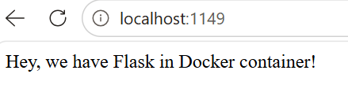

# Dockerized Flask Application

This project is a simple Flask web application running inside a Docker container. The application displays a message through a web page and demonstrates how to containerize and run a Flask application with Docker.

